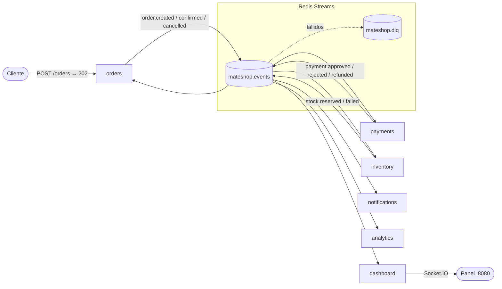

# 🧉 MateShop

Tienda online ficticia donde un pedido atraviesa varios microservicios que **nunca se llaman entre sí**: toda la coordinación ocurre publicando y consumiendo eventos en **Redis Streams**.
Un panel web muestra en tiempo real cada evento que viaja por el sistema. Es una demo didáctica de arquitectura orientada a eventos (EDA).



Más diagramas (C4, secuencias de la saga, ciclo de vida de un evento): [docs/architecture.md](docs/architecture.md).

## Requisitos

- **Docker Desktop** (con Docker Compose v2). Es lo único necesario para correr la demo.
- **Node.js 20+** solo para los atajos `npm run …` y para correr los tests desde tu máquina.

## Inicio rápido

```bash
npm install          # instala dependencias (para atajos y tests)
npm run up           # docker compose up --build -d
npm run order        # crea un pedido y muestra cómo termina
```

Abrí **http://localhost:8080** y mirá cómo viaja el pedido. Sin Node también funciona: `docker compose up --build`.

## Servicios y puertos

| Servicio | Puerto | Consumer group | Escucha | Publica | Estado propio |
|---|---|---|---|---|---|
| `orders` | **3000** (API REST) | `orders` | `payment.rejected`, `stock.reserved`, `payment.refunded` | `order.created`, `order.confirmed`, `order.cancelled` | `orders:*` |
| `payments` | — | `payments` | `order.created`, `stock.failed` | `payment.approved`, `payment.rejected`, `payment.refunded` | `payments:*` |
| `inventory` | — | `inventory` | `payment.approved` | `stock.reserved`, `stock.failed` | `inventory:*` |
| `notifications` | — | `notifications` | todos los de negocio | — (loguea "emails") | — |
| `analytics` | — (perfil `extra`) | `analytics` (desde ID 0) | `order.confirmed` | — | `analytics:*` |
| `dashboard` | **8080** (panel) | `dashboard` | todo (solo observa) | `demo.reset` | — |
| `redis` | **6379** | — | — | — | streams + claves |

Todos los servicios de negocio escuchan además `demo.reset` para borrar su estado.

### API de pedidos

```bash
curl -X POST http://localhost:3000/orders -H "Content-Type: application/json" \
  -d '{"customer":"Ana","items":[{"sku":"MATE-01","qty":1}],"total":15000}'
# → 202 {"orderId":"a149def9","status":"PENDING","correlationid":"order-a149def9",...}

curl http://localhost:3000/orders/a149def9   # estado actual del pedido
curl http://localhost:3000/orders            # últimos pedidos
```

Stock inicial: `MATE-01` (10), `BOMBILLA-02` (10), `YERBA-03` (2), `TERMO-04` (0). Límite de pago: $100.000.

## Catálogo de eventos

Todos viajan como sobre **CloudEvents 1.0** en el campo `event` de la entrada del stream `mateshop.events`. Contrato completo: [docs/asyncapi.yaml](docs/asyncapi.yaml) · schemas zod: [packages/contracts](packages/contracts/src/events.js).

| Tipo | Lo publica | Cuándo | `data` |
|---|---|---|---|
| `order.created` | orders | `POST /orders` válido | `orderId, customer, items, total` |
| `payment.approved` | payments | `total ≤ 100.000` | `orderId, customer, items, total, paymentId` |
| `payment.rejected` | payments | `total > 100.000` | `orderId, customer, total, reason` |
| `stock.reserved` | inventory | hay stock de todos los ítems | `orderId, customer, items` |
| `stock.failed` | inventory | falta algún ítem (no descuenta nada) | `orderId, customer, items, missing, reason` |
| `payment.refunded` | payments | compensación tras `stock.failed` | `orderId, customer, total, paymentId, reason` |
| `order.confirmed` | orders | tras `stock.reserved` | `orderId, customer, items, total` |
| `order.cancelled` | orders | tras `payment.rejected` o `payment.refunded` | `orderId, customer, reason` |
| `demo.reset` | dashboard | escena "Reiniciar demo" | `requestedBy` |

Ejemplo de sobre:

```json
{
  "specversion": "1.0",
  "id": "f3ee913d-9677-4865-8f78-fd32632e41a7",
  "type": "order.confirmed",
  "source": "/services/orders",
  "time": "2026-10-06T15:44:54.823Z",
  "subject": "order-a149def9",
  "datacontenttype": "application/json",
  "correlationid": "order-a149def9",
  "dataversion": "1",
  "data": { "orderId": "a149def9", "customer": "Ana", "items": [{ "sku": "MATE-01", "qty": 1 }], "total": 15000 }
}
```

## Escenas de la demo

Cada escena se puede disparar desde el **panel** (botones o teclas 1–7), con **npm** o con **make** (mismo nombre). El guion completo está en [docs/demo-script.md](docs/demo-script.md).

| Escena | Panel | npm | make |
|---|---|---|---|
| Pedido normal → CONFIRMED | 1 | `npm run order` | `make order` |
| Pedido que excede el límite → CANCELLED | 2 | `npm run order-rejected` | `make order-rejected` |
| Pedido sin stock (TERMO-04) → compensación | 3 | `npm run order-nostock` | `make order-nostock` |
| Ráfaga de 10 pedidos | 4 | `npm run burst` | `make burst` |
| Reenviar último evento (duplicado) | 5 | `npm run duplicate` | `make duplicate` |
| Evento envenenado → DLQ | 6 | `npm run poison` | `make poison` |
| Reiniciar demo | 7 | `npm run reset` | `make reset` |
| Apagar / prender notifications | — | `npm run kill-notifications` / `npm run revive-notifications` | `make kill-notifications` / `make revive-notifications` |
| Sumar analytics en vivo | — | `npm run add-analytics` | `make add-analytics` |
| Escalar payments a 2 réplicas | — | `npm run scale-payments` | `make scale-payments` |
| Logs combinados | — | `npm run logs` | `make logs` |
| Levantar / bajar todo | — | `npm run up` / `npm run down` | `make up` / `make down` |

> **¿No tenés `make`?** En Windows no viene instalado; usá los `npm run …` (hacen exactamente lo mismo). Si lo querés igual: `winget install GnuWin32.Make` o usá Git Bash con make.

## Tests

Los tests usan un Redis real (el de compose, base **15**, así no tocan los datos de la demo):

```bash
docker compose up -d redis   # o npm run up
npm test
```

| Archivo | Qué prueba |
|---|---|
| `tests/idempotency.test.js` | El mismo evento dos veces produce un solo efecto (también: stock descontado una sola vez) |
| `tests/saga-happy.test.js` | Pedido válido → `CONFIRMED`; pedido sobre el límite → `CANCELLED` |
| `tests/saga-compensation.test.js` | `TERMO-04` → `CANCELLED` + `payment.refunded`; reserva atómica |
| `tests/dlq.test.js` | Handler que siempre falla → `mateshop.dlq` tras 3 intentos; un reintento exitoso no va a la DLQ |
| `tests/validation.test.js` | Evento fuera de schema o JSON roto → DLQ; `publish()` rechaza eventos inválidos |
| `tests/recovery.test.js` | Al arrancar, un consumidor procesa primero sus pendientes |
| `tests/contracts.test.js` | Cada servicio escucha exactamente lo declarado en `SUBSCRIPTIONS` |

## Estructura

```
packages/
  contracts/    schemas zod + @typedef JSDoc de cada evento, sobre CloudEvents
  event-bus/    publish/subscribe, idempotencia, reintentos (XAUTOCLAIM), DLQ, heartbeat, apagado limpio
services/
  orders/  payments/  inventory/  notifications/  analytics/  dashboard/
docs/
  architecture.md  asyncapi.yaml  demo-script.md  adr/
scripts/        atajos de terminal (pedidos y escenas) usados por npm y make
tests/          Vitest contra Redis real
```

JavaScript puro con ES Modules: cada servicio corre directo con `node src/index.js`, sin TypeScript ni build.

## Decisiones de arquitectura (ADR)

- [0001 — EDA con coreografía](docs/adr/0001-eda-con-coreografia.md)
- [0002 — Redis Streams como broker (y por qué no Kafka)](docs/adr/0002-redis-streams-como-broker.md)
- [0003 — CloudEvents como formato](docs/adr/0003-cloudevents-como-formato.md)
- [0004 — At-least-once + idempotencia](docs/adr/0004-at-least-once-e-idempotencia.md)
- [0005 — Simplificaciones de la demo](docs/adr/0005-simplificaciones-de-la-demo.md)

## Troubleshooting

| Síntoma | Causa probable / solución |
|---|---|
| `npm run up` falla con *failed to connect to the docker API* | Docker Desktop no está abierto. Abrilo y esperá *Engine running*. |
| *port is already allocated* (3000, 6379 u 8080) | Otro programa usa ese puerto. Cerralo o cambiá el puerto en `docker-compose.yml`. |
| `npm test` dice *No se pudo conectar a Redis* | Falta Redis: `docker compose up -d redis`. |
| Los botones de pedidos dan error en el panel | La API de orders no responde en `:3000`: `docker compose ps` y `npm run logs`. |
| Un pedido queda en PENDIENTE | Algún servicio está caído (mirá la tarjeta *Servicios*). Al levantarlo, procesa lo pendiente. |
| El panel muestra cosas viejas | Botón **Reiniciar demo** o `npm run reset`. Para empezar de cero total: `npm run down`. |
| `make: command not found` | Usá `npm run <target>` (ver tabla de escenas). |
| Ver los streams a mano | `docker compose exec redis redis-cli XRANGE mateshop.events - +` · `XINFO GROUPS mateshop.events` · `XRANGE mateshop.dlq - +` |

## Glosario

- **Evento:** algo que *ya pasó* (en pasado: `order.created`). No es una orden.
- **Stream:** log ordenado y persistente de eventos en Redis.
- **Consumer group:** "suscripción con memoria" de un servicio: recuerda hasta dónde leyó y qué falta confirmar. Réplicas del mismo grupo se reparten el trabajo.
- **ACK:** confirmación de que un evento se procesó. Sin ACK, el evento queda **pendiente** (PEL).
- **At-least-once:** cada evento se entrega una vez *o más*; nunca cero.
- **Idempotencia:** procesar el mismo evento dos veces deja el mismo resultado que una.
- **DLQ (dead letter queue):** a dónde van los eventos que no se pueden procesar, para revisión humana.
- **Saga:** transacción de negocio repartida en pasos locales; si un paso falla, se **compensa** lo anterior.
- **Coreografía:** cada servicio reacciona a eventos; no hay un director central (eso sería *orquestación*).
- **Correlation ID:** identificador compartido por todos los eventos y logs de un mismo pedido (`order-<id>`).
- **CloudEvents:** estándar de la CNCF para el sobre de un evento.
- **Heartbeat:** latido periódico con TTL que indica que un servicio está vivo.
