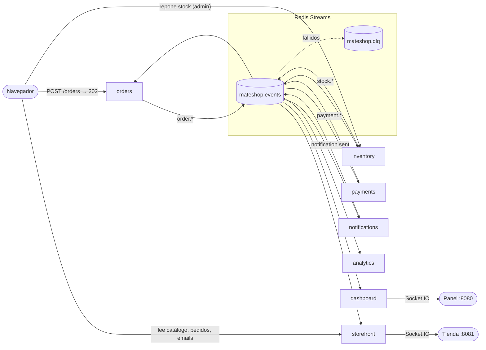

# 🧉 MateShop

Tienda online de mates donde un pedido atraviesa varios microservicios que **nunca se llaman entre sí**: toda la coordinación ocurre publicando y consumiendo eventos en **Redis Streams**.
Tiene dos vistas del mismo sistema: la **tienda** (vista de negocio, :8081) y el **panel técnico** (:8080), que muestra en tiempo real cada evento que viaja.



Más diagramas (C4, secuencias de la saga, compra desde la tienda, ciclo de vida de un evento): [docs/architecture.md](docs/architecture.md).

## Requisitos

- **Docker Desktop** (con Docker Compose v2). Es lo único necesario para correr la demo.
- **Node.js 20+** solo para los atajos `npm run …` y para correr los tests desde tu máquina.

## Inicio rápido

```bash
npm install          # instala dependencias (para atajos y tests)
npm run up           # docker compose up --build -d
npm run open-store   # muestra las URLs
```

| | URL |
|---|---|
| 🛒 Tienda | **http://localhost:8081** |
| 🔧 Administración de stock | **http://localhost:8081/admin** (sin login, **solo para la demo**) |
| 📡 Panel técnico | **http://localhost:8080** (filtrable: `/?order=<id>`) |
| API de pedidos | http://localhost:3000 |
| API de inventario (admin) | http://localhost:3001 |

Sin Node también funciona: `docker compose up --build`.

**Tarjetas de prueba** (los pagos son simulados, no ingreses datos reales):

| Tarjeta | Resultado |
|---|---|
| `4111 1111 1111 1111` (o cualquier otra) | aprobada |
| cualquiera terminada en `0000` | rechazada: "fondos insuficientes" |
| cualquiera, si el total supera $100.000 | rechazada: "límite excedido" |

## Servicios y puertos

| Servicio | Puerto | Consumer group | Escucha | Publica | Estado propio |
|---|---|---|---|---|---|
| `orders` | **3000** (API) | `orders` | `payment.rejected`, `stock.reserved`, `payment.refunded` | `order.created`, `order.confirmed`, `order.cancelled` | `orders:*` |
| `payments` | — | `payments` | `order.created`, `stock.failed` | `payment.approved`, `payment.rejected`, `payment.refunded` | `payments:*` |
| `inventory` | **3001** (admin) | `inventory` | `payment.approved` | `stock.reserved`, `stock.failed`, `stock.updated`, `stock.replenished` | `inventory:*` |
| `notifications` | — | `notifications` | los 8 eventos del pedido | `notification.sent` | `notifications:*` |
| `analytics` | — (perfil `extra`) | `analytics` (desde ID 0) | `order.confirmed` | — | `analytics:*` |
| `storefront` | **8081** (tienda) | `storefront` (desde ID 0) | eventos del pedido, `stock.updated`, `notification.sent` | — | `storefront:*` (modelo de lectura) |
| `dashboard` | **8080** (panel) | `dashboard` | todo (solo observa) | `demo.reset` | — |
| `redis` | **6379** | — | — | — | streams + claves |

Todos los servicios con estado escuchan además `demo.reset` para borrarlo (inventory vuelve a sembrar el stock).

### API de pedidos

```bash
curl -X POST http://localhost:3000/orders -H "Content-Type: application/json" \
  -d '{"customer":"Ana","email":"ana@ejemplo.com","cardNumber":"4111111111111111","items":[{"sku":"MATE-01","qty":1}]}'
# → 202 {"orderId":"a149def9","status":"PENDING","total":15000,"correlationid":"order-a149def9",...}

curl http://localhost:3000/orders/a149def9   # estado según orders
curl http://localhost:8081/api/orders/a149def9   # vista de la tienda (pasos, motivo legible)
```

El **total lo calcula orders** con el catálogo: si el cliente manda `total`, se ignora. De la tarjeta solo viajan los últimos 4 dígitos.

### API de administración de stock

```bash
curl -X POST http://localhost:3001/admin/stock/TERMO-04/replenish -H "Content-Type: application/json" -d '{"qty":5}'
# → {"sku":"TERMO-04","qty":5,"available":5}  y se publican stock.replenished + stock.updated
```

> ⚠️ La página `/admin` y esta API **no tienen login**: es una demo.

### Catálogo

10 productos en [packages/contracts/src/catalog.js](packages/contracts/src/catalog.js), con ilustraciones SVG propias.

| SKU | Producto | Precio | Stock inicial |
|---|---|---|---|
| MATE-01 | Mate de calabaza | $15.000 | 10 |
| BOMBILLA-02 | Bombilla de alpaca | $8.000 | 10 |
| YERBA-03 | Yerba mate 1 kg | $6.500 | 2 |
| TERMO-04 | Termo de acero 1 L | $45.000 | **0** |
| MATE-05 | Mate de algarrobo | $12.000 | 8 |
| MATE-06 | Mate imperial | $38.000 | 3 |
| BOMBILLA-07 | Bombilla pico de loro | $9.500 | 12 |
| YERBA-08 | Yerba barbacuá 500 g | $5.200 | 6 |
| MATERA-09 | Matera de cuero | $32.000 | 4 |
| AZUCARERA-10 | Set yerbera y azucarera | $11.000 | 5 |

## Catálogo de eventos

Todos viajan como sobre **CloudEvents 1.0** en el campo `event` de la entrada del stream `mateshop.events`. Contrato completo: [docs/asyncapi.yaml](docs/asyncapi.yaml) · schemas zod: [packages/contracts](packages/contracts/src/events.js).

| Tipo | Lo publica | Cuándo | `data` |
|---|---|---|---|
| `order.created` | orders | `POST /orders` válido | `orderId, customer, items, total` + opcionales `email, cardLast4` |
| `payment.approved` | payments | tarjeta OK y `total ≤ 100.000` | `orderId, customer, items, total, paymentId` |
| `payment.rejected` | payments | tarjeta `…0000` o `total > 100.000` | `orderId, customer, total, reason` |
| `stock.reserved` | inventory | hay stock de todos los ítems | `orderId, customer, items` |
| `stock.failed` | inventory | falta algún ítem (no descuenta nada) | `orderId, customer, items, missing, reason` |
| `payment.refunded` | payments | compensación tras `stock.failed` | `orderId, customer, total, paymentId, reason` |
| `order.confirmed` | orders | tras `stock.reserved` | `orderId, customer, items, total` |
| `order.cancelled` | orders | tras `payment.rejected` o `payment.refunded` | `orderId, customer, reason` |
| `stock.updated` | inventory | cada cambio de stock (siembra, reserva, reposición) | `sku, available` |
| `stock.replenished` | inventory | reposición desde el admin | `sku, qty, available` |
| `notification.sent` | notifications | cada "email" al cliente | `email, asunto, cuerpo, orderId` |
| `demo.reset` | dashboard | escena "Reiniciar demo" | `requestedBy` |

Ejemplo de sobre:

```json
{
  "specversion": "1.0",
  "id": "f3ee913d-9677-4865-8f78-fd32632e41a7",
  "type": "order.confirmed",
  "source": "/services/orders",
  "time": "2026-10-06T15:44:54.823Z",
  "subject": "order-a149def9",
  "datacontenttype": "application/json",
  "correlationid": "order-a149def9",
  "dataversion": "1",
  "data": { "orderId": "a149def9", "customer": "Ana", "items": [{ "sku": "MATE-01", "qty": 1 }], "total": 15000 }
}
```

## La tienda

- **Catálogo** con filtro por categoría, buscador y stock en vivo: si otro cliente compra, el número baja solo.
- **Detalle** con selector de cantidad limitado al stock. **Carrito** lateral guardado en `localStorage`.
- **Checkout** con validaciones y tarjeta simulada. La respuesta `202` lleva al **seguimiento**, que avanza en vivo: Pedido recibido → Pago aprobado → Stock reservado → Pedido confirmado. Si se cancela, muestra el motivo en lenguaje claro. El enlace **"Ver qué pasó por dentro"** abre el panel filtrado por ese pedido.
- **Mis pedidos** (por el email guardado en el navegador) y **campana** con los emails recibidos (`notification.sent`).
- **Admin** (`/admin`): stock en vivo con botón "Reponer stock" y todos los pedidos.

La tienda es un **modelo de lectura (CQRS)**: arma su propia vista en `storefront:*` solo con eventos y nunca lee claves de otro servicio ([ADR 0006](docs/adr/0006-tienda-como-modelo-de-lectura-cqrs.md)).

## Escenas de la demo

Cada escena se puede disparar desde el **panel** (botones o teclas 1–7), con **npm** o con **make** (mismo nombre). El guion completo, con tienda y panel lado a lado, está en [docs/demo-script.md](docs/demo-script.md).

| Escena | Panel | npm | make |
|---|---|---|---|
| Ver URLs de tienda, admin y panel | — | `npm run open-store` | `make open-store` |
| Pedido normal → CONFIRMED | 1 | `npm run order` | `make order` |
| Pedido que excede el límite → CANCELLED | 2 | `npm run order-rejected` | `make order-rejected` |
| Pedido sin stock (TERMO-04) → compensación | 3 | `npm run order-nostock` | `make order-nostock` |
| Ráfaga de 10 pedidos | 4 | `npm run burst` | `make burst` |
| Reenviar último evento (duplicado) | 5 | `npm run duplicate` | `make duplicate` |
| Evento envenenado → DLQ | 6 | `npm run poison` | `make poison` |
| Reiniciar demo (también limpia la vista de la tienda) | 7 | `npm run reset` | `make reset` |
| Apagar / prender notifications | — | `npm run kill-notifications` / `npm run revive-notifications` | `make kill-notifications` / `make revive-notifications` |
| Sumar analytics en vivo | — | `npm run add-analytics` | `make add-analytics` |
| Escalar payments a 2 réplicas | — | `npm run scale-payments` | `make scale-payments` |
| Logs combinados | — | `npm run logs` | `make logs` |
| Levantar / bajar todo | — | `npm run up` / `npm run down` | `make up` / `make down` |

> **¿No tenés `make`?** En Windows no viene instalado; usá los `npm run …` (hacen exactamente lo mismo). Si lo querés igual: `winget install GnuWin32.Make` o usá Git Bash con make.

## Tests

Los tests usan un Redis real (el de compose, base **15**, así no tocan los datos de la demo):

```bash
docker compose up -d redis   # o npm run up
npm test
```

| Archivo | Qué prueba |
|---|---|
| `tests/idempotency.test.js` | El mismo evento dos veces produce un solo efecto (también: stock descontado una sola vez) |
| `tests/saga-happy.test.js` | Pedido válido → `CONFIRMED`; sobre el límite → `CANCELLED`; tarjeta `…0000` → "fondos insuficientes" |
| `tests/saga-compensation.test.js` | `TERMO-04` → `CANCELLED` + `payment.refunded`; reserva atómica |
| `tests/pricing.test.js` | El total se calcula en el servidor e ignora el del cliente; SKU desconocido; la tarjeta completa no viaja |
| `tests/storefront.test.js` | El modelo de lectura refleja un pedido confirmado, uno cancelado sin stock y uno rechazado; bandeja de emails; reset |
| `tests/replenish.test.js` | La reposición publica `stock.replenished` + `stock.updated` y la tienda ve el valor nuevo |
| `tests/dlq.test.js` | Handler que siempre falla → `mateshop.dlq` tras 3 intentos; un reintento exitoso no va a la DLQ |
| `tests/validation.test.js` | Evento fuera de schema o JSON roto → DLQ; `publish()` rechaza eventos inválidos |
| `tests/recovery.test.js` | Al arrancar, un consumidor procesa primero sus pendientes |
| `tests/contracts.test.js` | Cada servicio escucha exactamente lo declarado en `SUBSCRIPTIONS` |

## Estructura

```
packages/
  contracts/    catálogo, schemas zod + @typedef JSDoc de cada evento, sobre CloudEvents
  event-bus/    publish/subscribe, idempotencia, reintentos (XAUTOCLAIM), DLQ, heartbeat, apagado limpio
services/
  orders/  payments/  inventory/  notifications/  analytics/
  storefront/   tienda: modelo de lectura + API de lectura + páginas (public/)
  dashboard/    panel técnico
docs/
  architecture.md  asyncapi.yaml  demo-script.md  adr/
scripts/        atajos de terminal (pedidos, escenas y URLs) usados por npm y make
tests/          Vitest contra Redis real
```

JavaScript puro con ES Modules: cada servicio corre directo con `node src/index.js`, sin TypeScript ni build.

## Decisiones de arquitectura (ADR)

- [0001 — EDA con coreografía](docs/adr/0001-eda-con-coreografia.md)
- [0002 — Redis Streams como broker (y por qué no Kafka)](docs/adr/0002-redis-streams-como-broker.md)
- [0003 — CloudEvents como formato](docs/adr/0003-cloudevents-como-formato.md)
- [0004 — At-least-once + idempotencia](docs/adr/0004-at-least-once-e-idempotencia.md)
- [0005 — Simplificaciones de la demo](docs/adr/0005-simplificaciones-de-la-demo.md)
- [0006 — La tienda como modelo de lectura (CQRS)](docs/adr/0006-tienda-como-modelo-de-lectura-cqrs.md)
- [0007 — Simplificaciones de la tienda](docs/adr/0007-simplificaciones-de-la-tienda.md)

## Troubleshooting

| Síntoma | Causa probable / solución |
|---|---|
| `npm run up` falla con *failed to connect to the docker API* | Docker Desktop no está abierto. Abrilo y esperá *Engine running*. |
| *port is already allocated* (3000, 3001, 6379, 8080 u 8081) | Otro programa usa ese puerto. Cerralo o cambiá el puerto en `docker-compose.yml`. |
| `npm test` dice *No se pudo conectar a Redis* | Falta Redis: `docker compose up -d redis`. |
| La tienda dice "No pudimos contactar al servicio de pedidos" | orders no responde en `:3000`: `docker compose ps` y `npm run logs`. |
| El seguimiento queda en "registrando…" o un pedido en PENDIENTE | Algún servicio está caído (mirá la tarjeta *Servicios* del panel). Al levantarlo, procesa lo pendiente. |
| "Reponer stock" falla en el admin | inventory no responde en `:3001`. |
| El carrito tiene productos viejos | Se guarda en el navegador: quitalos desde el carrito (o borrá los datos del sitio). |
| El panel o la tienda muestran cosas viejas | Botón **Reiniciar demo** o `npm run reset`. Para empezar de cero total: `npm run down`. |
| `make: command not found` | Usá `npm run <target>` (ver tabla de escenas). |
| Ver los streams a mano | `docker compose exec redis redis-cli XRANGE mateshop.events - +` · `XINFO GROUPS mateshop.events` · `XRANGE mateshop.dlq - +` |

## Glosario

- **Evento:** algo que *ya pasó* (en pasado: `order.created`). No es una orden.
- **Stream:** log ordenado y persistente de eventos en Redis.
- **Consumer group:** "suscripción con memoria" de un servicio: recuerda hasta dónde leyó y qué falta confirmar. Réplicas del mismo grupo se reparten el trabajo.
- **ACK:** confirmación de que un evento se procesó. Sin ACK, el evento queda **pendiente** (PEL).
- **At-least-once:** cada evento se entrega una vez *o más*; nunca cero.
- **Idempotencia:** procesar el mismo evento dos veces deja el mismo resultado que una.
- **DLQ (dead letter queue):** a dónde van los eventos que no se pueden procesar, para revisión humana.
- **Saga:** transacción de negocio repartida en pasos locales; si un paso falla, se **compensa** lo anterior.
- **Coreografía:** cada servicio reacciona a eventos; no hay un director central (eso sería *orquestación*).
- **CQRS:** separar el camino que escribe (comandos) del que lee (consultas); la tienda lee de su propia vista armada con eventos.
- **Modelo de lectura:** copia de datos con la forma que necesita una pantalla, mantenida por eventos.
- **Consistencia eventual:** las vistas se ponen al día unos milisegundos después del cambio.
- **Correlation ID:** identificador compartido por todos los eventos y logs de un mismo pedido (`order-<id>`).
- **CloudEvents:** estándar de la CNCF para el sobre de un evento.
- **Heartbeat:** latido periódico con TTL que indica que un servicio está vivo.
