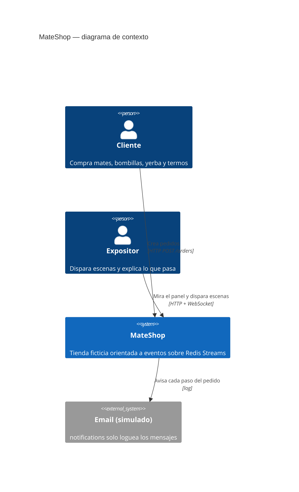
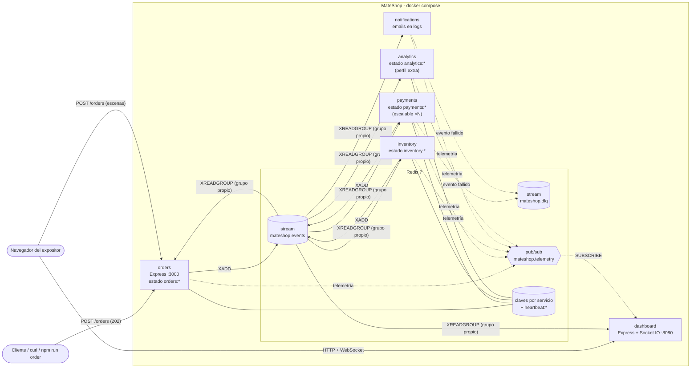
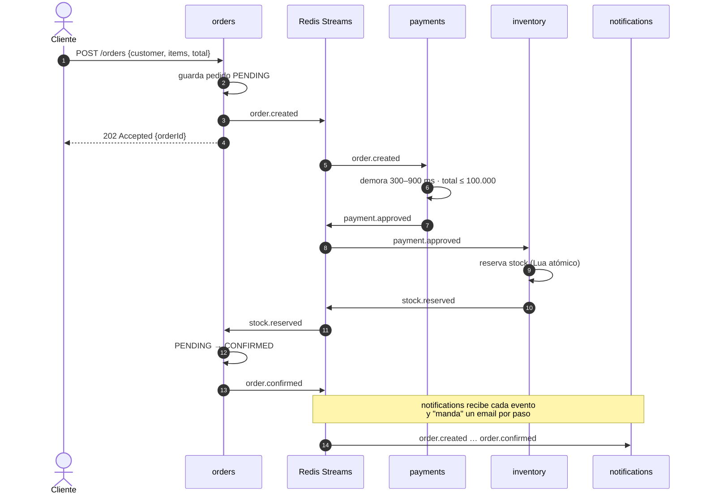
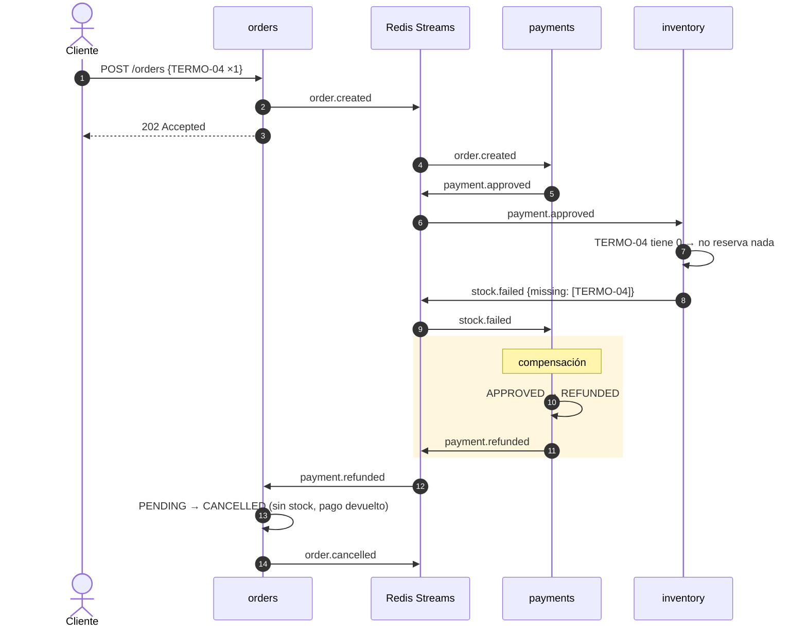
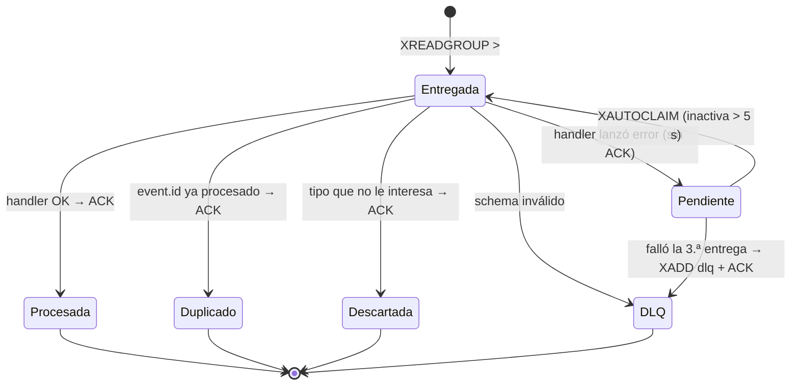

# Arquitectura de MateShop

MateShop es una saga **coreografiada**: cada servicio reacciona a eventos y publica los suyos en un único stream de Redis (`mateshop.events`). Nadie llama a nadie por HTTP; la única entrada HTTP es la API de pedidos.

## (a) Contexto (C4 nivel 1)

## (b) Contenedores (C4 nivel 2)

**Reglas:**

- Cada servicio tiene su *consumer group* y por eso recibe **todos** los eventos (difusión); procesa solo los tipos que le interesan y hace ACK del resto.
- Dentro de un grupo las réplicas se reparten las entradas (`npm run scale-payments`).
- `packages/contracts` (schemas zod + JSDoc) y `packages/event-bus` (publish/subscribe, idempotencia, reintentos, DLQ, heartbeat) son las únicas piezas compartidas.

## (c) Saga feliz

## (d) Saga con compensación (sin stock)

Variante "límite excedido": si `total > 100.000`, payments publica `payment.rejected` y orders cancela el pedido sin pasar por inventory.

## Ciclo de vida de una entrada en un consumer group

