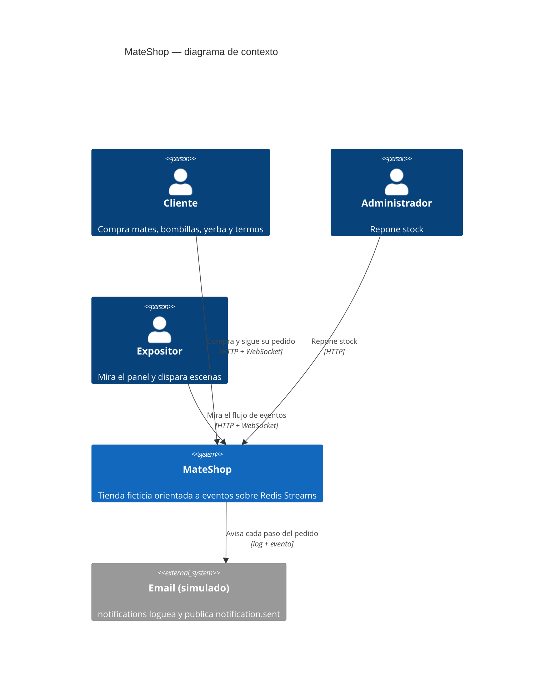
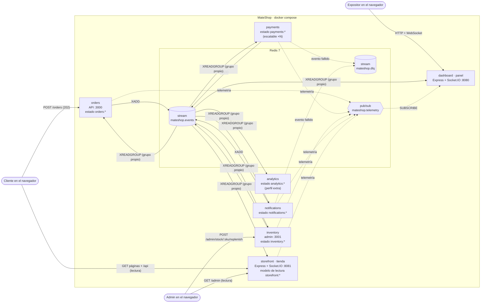
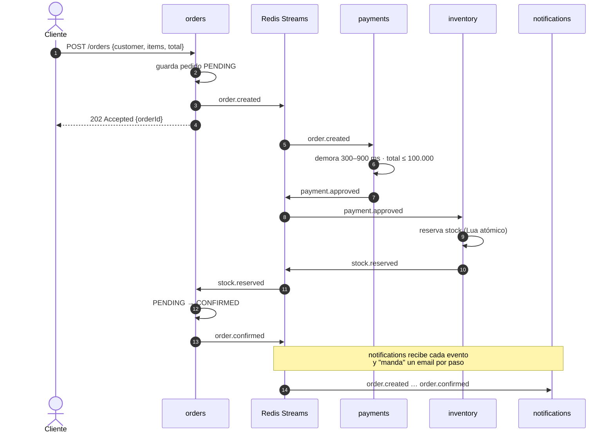
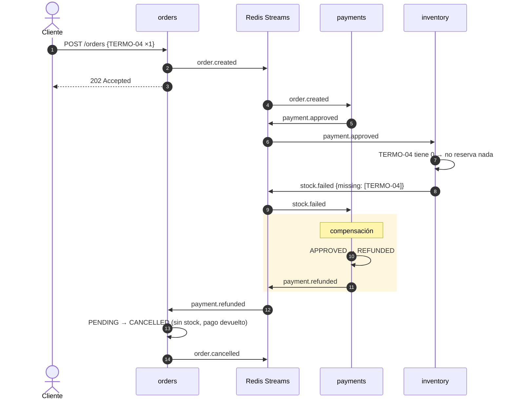
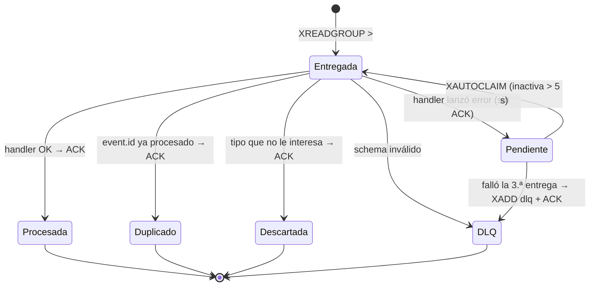
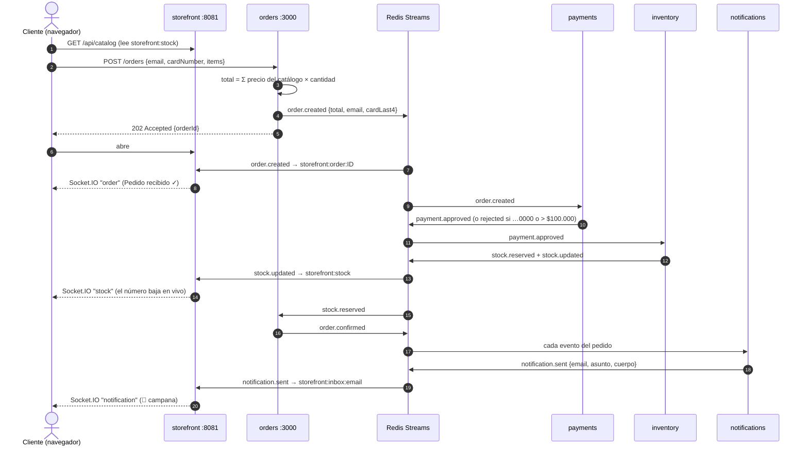

# Arquitectura de MateShop

MateShop es una saga **coreografiada**: cada servicio reacciona a eventos y publica los suyos en un único stream de Redis (`mateshop.events`). Ningún servicio llama a otro por HTTP. Las únicas entradas HTTP son las APIs que usa el navegador: pedidos (:3000), administración de stock (:3001), la tienda (:8081, solo lectura) y el panel (:8080).

Hay dos vistas sobre el mismo sistema:

- **Tienda** (`storefront`, :8081): vista de negocio. Es un **modelo de lectura CQRS** armado solo con eventos (ADR 0006).
- **Panel** (`dashboard`, :8080): vista técnica que muestra cada evento que viaja.

## (a) Contexto (C4 nivel 1)

## (b) Contenedores (C4 nivel 2)

**Reglas:**

- Cada servicio tiene su *consumer group* y por eso recibe **todos** los eventos (difusión); procesa solo los tipos que le interesan y hace ACK del resto.
- Dentro de un grupo las réplicas se reparten las entradas (`npm run scale-payments`).
- Cada servicio guarda su estado en Redis bajo su prefijo y nunca lee el de otro.
- `packages/contracts` (catálogo, schemas zod y JSDoc) y `packages/event-bus` (publish/subscribe, idempotencia, reintentos, DLQ, heartbeat) son las únicas piezas compartidas.

## (c) Saga feliz

## (d) Saga con compensación (sin stock)

Variante "límite excedido": si `total > 100.000`, payments publica `payment.rejected` y orders cancela el pedido sin pasar por inventory.

## Ciclo de vida de una entrada en un consumer group

## (e) Compra desde la tienda (CQRS)

Comandos por un lado (navegador → orders / inventory), consultas por otro (navegador → modelo de lectura de la tienda).

Reposición: el admin hace `POST :3001/admin/stock/:sku/replenish` → inventory publica `stock.replenished` y `stock.updated` → la tienda actualiza su vista y avisa a todos los navegadores.
